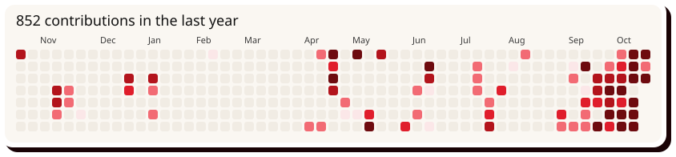

<!-- red0-x profile. Style: red0xx v2 sticker system (red field, paper stickers, hard #190306 shadows).
     Rebuild banner + section stickers: python3 scripts/build_assets.py -->

  

  
  
  
  

Hey, i'm red0xx. 
homelabber, music producer, chart watcher, linguist and more
I enjoy making broken circuit boards and slop and learning languages like spanish and mandarin
I make many random projects that I will never touch again. 

  
  

  

  

  
  
  
  

one of my sites lol

